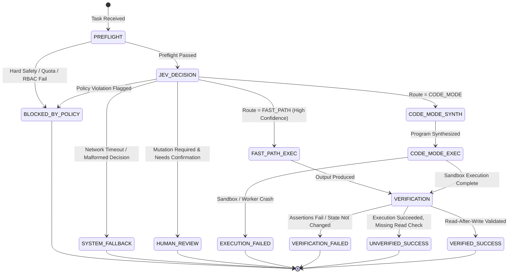

# Reflex: Architectural Specification & Protocol Definition
## Document: ARCHITECTURE.md

---

## 1. Formal State Machine & Lifecycle Transitions

Reflex models an execution as a deterministic finite state machine (FSM). 
Transitions are recorded into the telemetry log with sub-millisecond timestamps.



### State Machine Transition Rules:
1. **PREFLIGHT -> JEV_DECISION**: Only if input satisfies schema, passes hard regex filters, and user quota is sufficient.
2. **JEV_DECISION -> FAST_PATH_EXEC**: Only if `route === 'FAST_PATH'`, confidence $\ge \tau_{\text{conf}}$ (default `0.75`), and `requiresMutation === false`.
3. **JEV_DECISION -> CODE_MODE_SYNTH**: If `route === 'CODE_MODE'` and no hard blocking conditions exist.
4. **JEV_DECISION -> HUMAN_REVIEW**: If `requiresMutation === true` AND policy specifies `requireApprovalForMutations === true`.
5. **VERIFICATION -> VERIFIED_SUCCESS**: Requires both Layer 1 (Deterministic Status 2xx/Output schema) AND Layer 2 (Authoritative Read-after-write) to pass.

---

## 2. Jev Decisions API: Exact Wire Protocol

Jev evaluates bounded decisions via structured question declarations.

### 2.1. Request Schema (Batched Multi-Question)
Reflex dispatches a single batched payload to `POST https://api.typesafe.ai/v1/systemone` or `POST https://openrouter.ai/api/alpha/decisions`:

```json
{
  "context": {
    "task": "Find all staging deployments with 0 traffic for >7 days and delete them.",
    "environment": "staging",
    "caller_role": "developer",
    "available_tools": ["deployments.list", "deployments.delete", "metrics.traffic"]
  },
  "questions": [
    {
      "id": "route_selection",
      "type": "choice",
      "prompt": "Select the optimal execution route for this task.",
      "options": [
        "FAST_PATH",
        "CODE_MODE",
        "ASK_USER",
        "BLOCK"
      ]
    },
    {
      "id": "policy_risk",
      "type": "noul",
      "prompt": "Does this request attempt an unauthorized, dangerous, or production-breaking mutation?"
    },
    {
      "id": "complexity_score",
      "type": "score",
      "prompt": "Evaluate task complexity from 1 (single deterministic lookup) to 5 (multi-step cross-API orchestration).",
      "min": 1,
      "max": 5
    },
    {
      "id": "requires_mutation",
      "type": "noul",
      "prompt": "Will fulfilling this task modify, delete, or create persistent state in any external system?"
    }
  ]
}
```

### 2.2. Expected Response Schema
```json
{
  "decision_id": "dec_01HZ89X...",
  "latency_ms": 112,
  "usage": {
    "input_tokens": 84,
    "output_tokens": 12
  },
  "answers": {
    "route_selection": {
      "type": "choice",
      "selected": "CODE_MODE",
      "probabilities": {
        "FAST_PATH": 0.05,
        "CODE_MODE": 0.91,
        "ASK_USER": 0.03,
        "BLOCK": 0.01
      },
      "confidence": 0.91
    },
    "policy_risk": {
      "type": "noul",
      "judgment": false,
      "probability": 0.08
    },
    "complexity_score": {
      "type": "score",
      "value": 4.2,
      "normalized": 0.84
    },
    "requires_mutation": {
      "type": "noul",
      "judgment": true,
      "probability": 0.96
    }
  }
}
```

---

## 3. Cloudflare Code Mode & Host Tool Proxy

### 3.1. Sandbox Isolation Architecture
Cloudflare Code Mode uses isolated V8 isolates (Cloudflare Workers). 
**CRITICAL SECURITY INVARIANT**:
> The JavaScript code written by the generative model inside the Worker **NEVER** holds API keys, database credentials, or direct TCP sockets to internal systems.

Instead, the Worker sandbox has access only to an RPC client that communicates over an isolated channel with the **Reflex Host Tool Proxy**.

```
┌────────────────────────────────────────────────────────┐
│ CLOUDFLARE WORKER / V8 SANDBOX (Untrusted Code)       │
│                                                        │
│  const deps = await mcp.deployments.list({ env });     │
│  for (const d of deps) {                               │
│    if (d.traffic === 0) {                              │
│      await mcp.deployments.delete({ id: d.id });       │
│    }                                                   │
│  }                                                     │
└───────────────────────────┬────────────────────────────┘
                            │ (RPC Call: toolName + args)
                            ▼
┌────────────────────────────────────────────────────────┐
│ REFLEX HOST TOOL PROXY (Trusted Node / Edge Runtime)   │
│                                                        │
│  1. Ingress Filter: Validate Schema & Permissions      │
│  2. Mutex / Idempotency Check: Validate token          │
│  3. Evidence Ledger: Log tool call + input args        │
│  4. Authorization Callback: Check approval if mutating │
│  5. Real Dispatch: Call MCP Server or Upstream API     │
│  6. Egress Capture: Record status code & raw response  │
└────────────────────────────────────────────────────────┘
```

### 3.2. Host Tool Proxy Interface
```typescript
export interface IHostToolProxy {
  /**
   * Dispatches a tool invocation from the sandbox through the host authorization boundary.
   */
  invokeTool(
    taskId: string,
    toolName: string,
    params: Record<string, unknown>
  ): Promise<ToolInvocationResponse>;
}

export interface ToolInvocationResponse {
  callId: string;
  success: boolean;
  httpStatus: number;
  data: unknown;
  error?: string;
  isMutation: boolean;
  durationMs: number;
}
```

---

## 4. The Verification Engine & Evidence Ledger

### 4.1. Verification Layer Matrix

| Layer | Type | Mechanism | Speed | Authority | When Used |
|---|---|---|---|---|---|
| **Layer 1** | Deterministic Assertions | Status codes (200 OK), JSON Schema matches, non-empty arrays | < 2ms | High | Every execution |
| **Layer 2** | Authoritative Read-After-Write | Out-of-band query directly to source-of-truth API to confirm state | 50-300ms | Absolute | Any task mutating state |
| **Layer 3** | Semantic Verification | Jev `noul` question asking if evidence satisfies criteria | 100-200ms | Bounded | Open-ended summaries |

### 4.2. Declarative Verification Contract Definition
Developers and agents define verification expectations using a declarative contract:

```typescript
export interface VerificationContract {
  preconditions?: {
    description: string;
    check: (ctx: TaskContext) => Promise<boolean>;
  }[];
  readAfterWrite?: {
    targetResource: string;
    query: (evidence: ToolInvocationEvidence[]) => Promise<unknown>;
    assert: (readState: unknown, evidence: ToolInvocationEvidence[]) => boolean | Promise<boolean>;
    failureMessage: string;
  }[];
  deterministicAssertions?: {
    field: string;
    operator: 'equals' | 'contains' | 'matches' | 'schema';
    expected: unknown;
  }[];
}
```

### 4.3. Concrete Example: Verifying Staging Deployment Deletion
```typescript
const deleteStagingVerificationContract: VerificationContract = {
  readAfterWrite: [
    {
      targetResource: "deployments",
      query: async (evidence) => {
        // Collect all IDs the agent claimed to delete
        const deletedIds = evidence
          .filter(e => e.toolName === "deployments.delete" && e.httpStatus === 200)
          .map(e => (e.inputPayload as { id: string }).id);
        
        // Re-query authoritative Cloudflare / Platform API
        const statusChecks = await Promise.all(
          deletedIds.map(id => api.deployments.get(id).catch(err => ({ status: 404 })))
        );
        return { deletedIds, statusChecks };
      },
      assert: (result: any) => {
        // Must all be 404 Not Found or status === 'deleted'
        return result.statusChecks.every((check: any) => 
          check.status === 404 || check.data?.status === "deleted"
        );
      },
      failureMessage: "One or more targeted deployments are still active in the authoritative API."
    }
  ]
};
```

---

## 5. Benchmarking & Evaluation Methodology

To validate Reflex empirically against alternative architectures:

### 5.1. The 3 Comparison Baselines:
1. **Baseline A (Conventional ReAct)**: Frontier LLM calling tools one-by-one via standard JSON tool-calling API.
2. **Baseline B (Raw Code Mode)**: Generative LLM writing orchestration code executed in Cloudflare Code Mode with unverified self-reported outcomes.
3. **Candidate C (Reflex OVEK)**: Jev routing -> (Fast Path / Code Mode) -> Host Tool Proxy -> Tri-Layer Verification Engine.

### 5.2. Core Evaluation Metrics Table

| Metric | Definition | Target for Reflex vs Baseline A |
|---|---|---|
| **Cost Per Successful Task ($)** | Total USD spent across all calls / Number of verified successful completions | **-40% to -70%** |
| **p50 Latency (ms)** | Median time to terminal state | **-50%** (via Code Mode script batching & Fast Path) |
| **Unnecessary Slow-Path Rate (%)** | Fraction of requests routed to LLM that could have been resolved via Fast Path | **< 5%** |
| **False-Safe Completion Rate (%)** | Fraction of runs where agent reports success but state was NOT changed | **0.0%** (Reflex verifier catches 100% of lying agents) |
| **Task Completion Rate (%)** | Fraction of valid tasks completed without human intervention | **$\ge$ Baseline B** |
