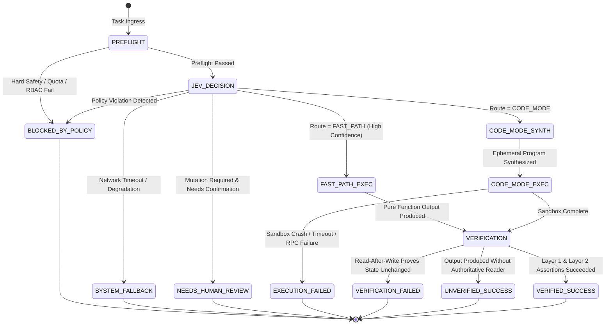

# Reflex Engine: Architecture & Overview

## 1. Executive Summary: The Outcome-Verified Execution Kernel (OVEK)

Contemporary autonomous agent systems rely predominantly on the **ReAct pattern** (Reasoning + Acting loop): an iterative prompt-completion loop that roundtrips to a large generative language model for every individual tool call. In enterprise production environments, this paradigm suffers from three critical architectural flaws:

1. **High Latency & Escalating API Costs**: Multi-step workflows require 5 to 10 sequential model roundtrips, generating hundreds of seconds of user wait time and unbounded token burn.
2. **Ungrounded Completion Claims ("Lying Agents")**: Generative LLMs routinely announce success (*"Successfully deleted staging deployments"*) even when downstream tool invocations timed out, threw HTTP 403 Forbidden, or silently failed. Frameworks that trust self-reported success create catastrophic risk.
3. **Pseudosafety & Authorization Drift**: Passing direct API credentials or host permissions into the agent's context or untrusted sandbox scripts forfeits host-side authorization boundaries.

**Reflex** replaces the vulnerable ReAct loop with the **Outcome-Verified Execution Kernel (OVEK)**. Reflex decomposes agentic execution into three strictly decoupled layers:

```
┌─────────────────────────────────────────────────────────────────────────┐
│                       1. DECISION LAYER (Jev)                           │
│  • Bounded, typed, batched decisions (choice, score, noul)               │
│  • 100-200ms latency, zero streaming hallucination                     │
└────────────────────────────────────┬────────────────────────────────────┘
                                     │
                                     ▼
┌─────────────────────────────────────────────────────────────────────────┐
│              2. EXECUTION LAYER (Cloudflare Code Mode)                  │
│  • Generative LLM synthesizes an ephemeral JavaScript program           │
│  • Program executes in isolated Cloudflare Worker / V8 isolate          │
│  • Host Tool Proxy intercepts all mutation RPC calls at host boundary   │
└────────────────────────────────────┬────────────────────────────────────┘
                                     │
                                     ▼
┌─────────────────────────────────────────────────────────────────────────┐
│              3. VERIFICATION & EVIDENCE PLANE (Reflex Core)             │
│  • Tri-Layer Verification (Schema -> Read-After-Write -> Semantic)      │
│  • Cryptographic Evidence Ledger signed with asymmetric Ed25519         │
│  • 100% interception rate of simulated lying agent vectors              │
└─────────────────────────────────────────────────────────────────────────┘
```

---

## 2. Core Axioms (Non-Negotiable Engine Invariants)

- **Axiom 1: Jev proposes; Deterministic Policy disposes.**  
  A machine learning model's confidence or route classification is purely advisory. Policy engine rules, role-based access control, tenant quotas, and freeze windows are authoritative and deterministic.
- **Axiom 2: Sandboxes are for execution isolation, NOT authorization.**  
  Worker isolates and sandboxes never hold direct credentials or unrestricted sockets. Tool dispatch routes across an isolated RPC boundary to the host-side `HostToolProxy`.
- **Axiom 3: Execution is not verification.**  
  A synthesized script exiting with return code 0 or returning `{ success: true }` is merely *attempted*. Success is granted only when independent, authoritative postconditions pass (Layer 2 Read-After-Write).
- **Axiom 4: Zero model calls when code suffices.**  
  If regex, schemas, preflight rules, cached decisions, or compiled fast-paths can resolve or block a request, neither Jev nor generative models are invoked.

---

## 3. Formal Execution Lifecycle State Machine



### Execution Steps:
1. **Deterministic Preflight (`PreflightValidator`)**:
   - Validates task payload against `TaskContextSchema` (Zod).
   - Scans against destructive patterns (fork bombs, `rm -rf`, destructive SQL).
   - Validates tenant quotas (tasks per minute, active concurrency, monthly USD budget).
   - Evaluates tenant freeze windows and environment whitelists.
2. **Jev Decision Engine (`JevClient`)**:
   - Single batched query evaluating `route_selection`, `policy_risk`, `complexity_score`, and `requires_mutation`.
   - Returns bounded structured outputs in 50–150ms.
3. **Execution Routing**:
   - **FAST_PATH**: Invokes pre-registered pure handlers or compiled fast-path regex rules in < 5ms at $0.00 cost.
   - **CODE_MODE**: Synthesizes an ephemeral JavaScript orchestration program, executing inside an isolated V8 isolate sandbox.
4. **Host Authorization Boundary (`HostToolProxy`)**:
   - Intercepts all sandbox tool calls over an RPC bridge.
   - Enforces role tool allowlists/denylists, idempotency locks, and tenant blast radius limits.
   - Records input/output payloads and timestamps directly into the `EvidenceLedger`.
5. **Tri-Layer Verification Engine (`VerificationEngine`)**:
   - **Layer 1**: Deterministic schema assertions and HTTP 2xx verification.
   - **Layer 2**: Authoritative Read-After-Write out-of-band verification proving state mutation occurred.
   - **Layer 3**: Bounded semantic postcondition verification via Jev `noul`.
6. **Outcome Dispatch**:
   - Signs the immutable `EvidenceLedger` using Ed25519 cryptography.
   - Emits OpenTelemetry spans (`reflex.task`, `reflex.preflight`, `reflex.tool.*`, `reflex.verify.*`).
   - Persists evidence to memory, filesystem, or SQLite ledger store.
